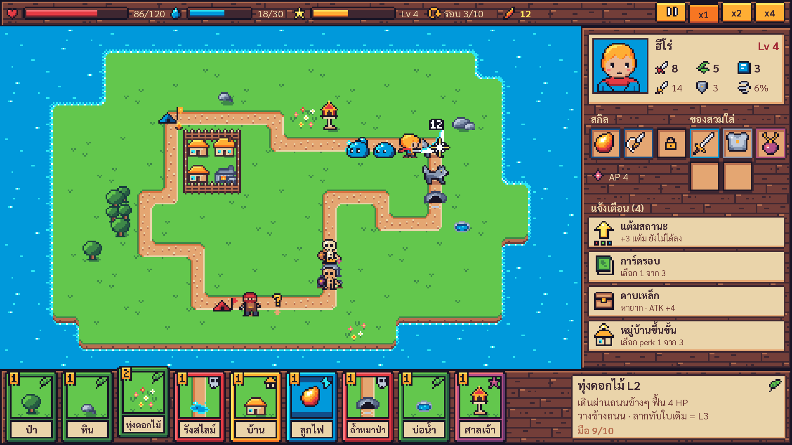
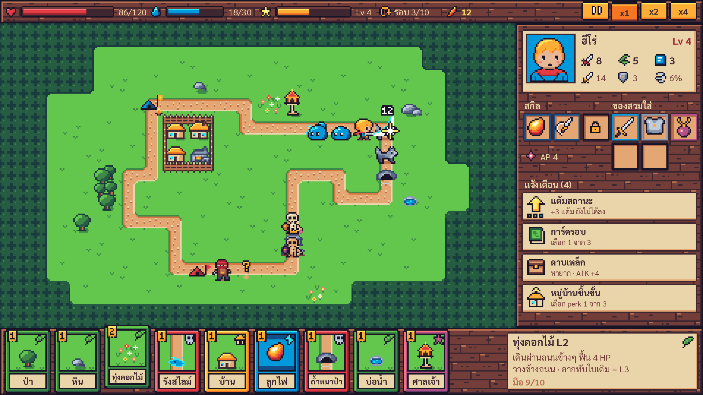
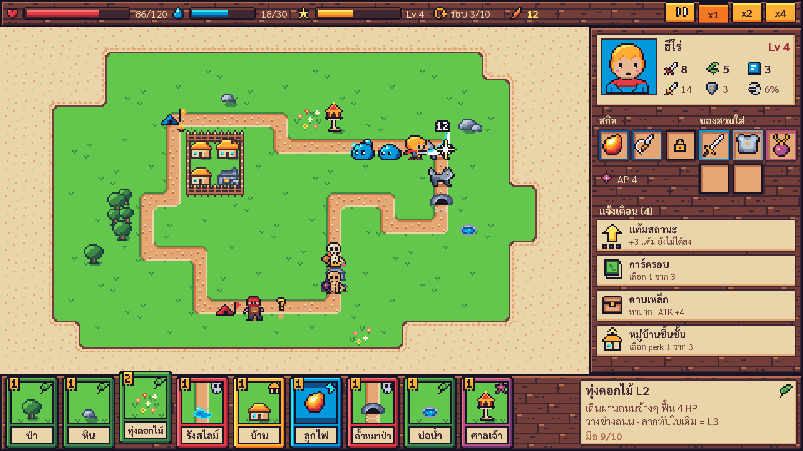
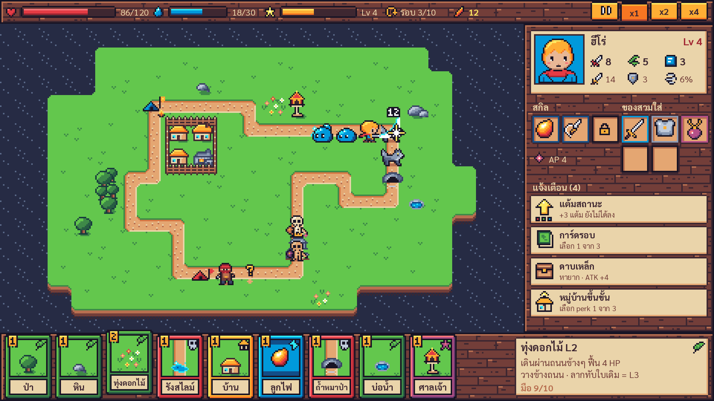
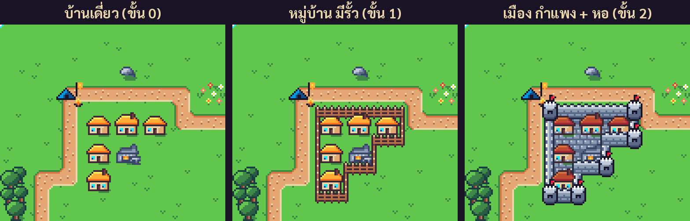
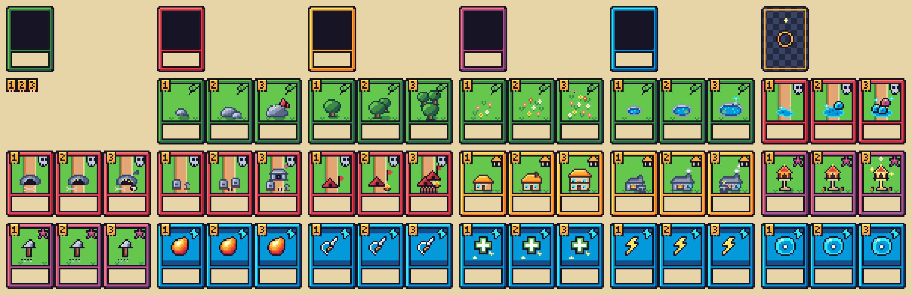

# Art bible · Loop Rebirth

เอกสารนี้คือกติกาของภาพทั้งเกม ใครวาดเพิ่มหรือแก้ภาพให้ยึดตามนี้ ไฟล์ภาพจริงอยู่ที่ `assets/art/` และสร้างจากโค้ดใน `tools/art/` ด้วย `python3 tools/art/build.py`

## ทิศทางภาพ

- **โทนสดใส อบอุ่น** แบบ RPG pixel art ยุค 16-bit ให้ต่างจาก Loop Hero ที่มืด แผนที่ต้องเป็นส่วนที่สว่างและมีสีที่สุดบนจอ UI เป็นไม้สีเข้มกับกระดาษสีครีมล้อมรอบ
- **มุมกล้อง top-down 3/4** แบบ JRPG เห็นด้านบนและด้านหน้าของวัตถุ วัตถุสูงยื่นขึ้นไปทับช่องข้างบนได้
- **แผนที่เป็นเกาะกลางทะเล** ถนน loop อยู่บนเกาะ รอบเกาะเป็นทะเลสีฟ้า (Phupha เลือก 26 ต.ค. 2026) อีก 3 แบบเก็บไว้เป็นทางเลือก
- **อ่านออกในพริบตา** ผู้เล่นต้องรู้ว่าอะไรอยู่ตรงไหนโดยไม่ต้องอ่านตัวเลข โดยเฉพาะเมืองที่โตขึ้น ซึ่งเป็นจุดขายหลัก

## ขนาดและตาราง

| ของ | ขนาด (px) | จุดยึด |
| --- | --- | --- |
| หน้าจอ | 480 x 270 ขยาย x4 เป็น 1920 x 1080 | |
| ช่องบนแผนที่ | 16 x 16 (แผนที่ 22 x 13 ช่อง = 352 x 208) | |
| วัตถุบนแผนที่ (การ์ด) | เฟรม 16 x 24, 3 เฟรม = เลเวล 1-3 | กึ่งกลางล่างของช่อง ส่วนบน 8 px ยื่นขึ้นได้ |
| ฮีโร่ ศัตรู | 16 x 16 | กึ่งกลางล่าง (เท้าอยู่แถวล่างสุด) |
| บอส | 32 x 32 | กึ่งกลางล่าง |
| การ์ด | 32 x 44 | |
| ไอคอน | 16 x 16 และ 8 x 8 | |
| เอฟเฟกต์ | 16 x 16 (เลเวลอัป 16 x 24, ลูกไฟ 8 x 8) | กึ่งกลาง (เลเวลอัปยึดล่าง) |

layout หน้าจอตาม prototype: แถบบน 16 px, แผนที่ (0, 16), แผงขวา 128 x 208, มือการ์ด 480 x 46

## Palette: Endesga 32

ทุก pixel ต้องเป็นหนึ่งใน 32 สีนี้ หรือโปร่งใสสนิท ห้าม anti-alias ห้ามโปร่งแสงครึ่งๆ (build จะ fail) ไฟล์ palette อยู่ที่ `assets/art/palette/` (`.png`, `.hex`, `.gpl` สำหรับ Aseprite/GIMP)

ในโค้ดวาดภาพแต่ละสีแทนด้วยตัวอักษร 1 ตัว (ดู `tools/art/pal.py`) ตัวที่ใช้บ่อย:

| ตัว | สี | ใช้กับ |
| --- | --- | --- |
| `k` | `#181425` | เส้นขอบตัวละคร, เงามืดสุด |
| `D` `d` `b` | `#3e2731` `#733e39` `#b86f50` | ไม้, กรอบ UI, ตัวหนังสือบนกระดาษ (`D`) |
| `c` `t` `o` | `#ead4aa` `#e4a672` `#d77643` | กระดาษ UI, ถนน, ผิวทราย |
| `H` `h` `G` `g` | `#193c3e` `#265c42` `#3e8948` `#63c74d` | หญ้า ต้นไม้ (`g` คือหญ้าหลัก) |
| `N` `B` `u` `a` | `#262b44` `#124e89` `#0099db` `#2ce8f5` | น้ำ, mana, สกิล |
| `n` `S` `s` `l` `w` | `#3a4466` ถึง `#ffffff` | หิน, เหล็ก, กำแพง |
| `R` `e` `P` | `#a22633` `#e43b44` `#f6757a` | HP, ศัตรู, ธง |
| `O` `y` `Y` | `#f77622` `#feae34` `#fee761` | ทอง, ไฟ, XP, หลังคาฟาง |
| `p` `m` | `#68386c` `#b55088` | ของพิเศษ, elite, epic |
| `f` `F` | `#e8b796` `#c28569` | ผิว |

### สีมีความหมาย

| เรื่อง | สี |
| --- | --- |
| ประเภทการ์ด | ภูมิประเทศ = เขียว, encounter = แดง, อาคาร = เหลืองอำพัน, พิเศษ = ม่วง, สกิล = ฟ้า |
| ค่าของฮีโร่ | HP แดง, mana ฟ้า, XP เหลือง, Rebirth point = ส้มชมพู (ขนนกฟีนิกซ์) |
| stat | STR แดง, AGI เขียว, INT ฟ้า |
| ความหายากของ | ธรรมดา เทา, หายาก ฟ้า, epic ม่วงชมพู |
| ไฮไลต์ช่องวางการ์ด | วางได้ ขาว, วางไม่ได้ แดงสด, merge เหลือง, combo ฟ้าอ่อน, combo ลบ แดงมีเครื่องหมาย ! |

## กติกาการวาด

- **แสงมาจากซ้ายบน** ด้านขวาและด้านล่างของทุกอย่างเข้มกว่า
- **เส้นขอบ** ตัวละครและการ์ดใช้ `k` รอบตัว วัตถุบนแผนที่ใช้สีเข้มสุดของวัสดุตัวเอง (ต้นไม้ `H`, หิน `n`, บ้าน `D`) พื้นและถนนไม่มีเส้นขอบ
- **เงา** ต้นไม้และบ้านมีเงาสี `G` วาดติดมากับภาพ ตัวละครมีเงาแยก (`units/shadow.png`) วาดก่อนตัวละคร
- **ทึบเท่านั้น** ถ้าต้องการให้จางหรือกะพริบ ทำในเกมด้วย modulate ไม่ใช่ในภาพ
- **เลเวลการ์ด** L2 L3 ต้องดูหนาแน่นหรือใหญ่ขึ้นจนเห็นจากระยะไกล และ L3 มีรายละเอียดพิเศษ 1 อย่าง (ผีเสื้อ, คริสตัล, ธง, ประกาย)
- **elite** ใช้ภาพเดิมเปลี่ยนชุดสี + มงกุฎ (`units/crown.png`) เหนือหัว

## พื้นและถนน

- **พื้นแบบ dual-grid** ภาพ tile วางที่มุมของช่อง (เลื่อน -8, -8) แต่ละ tile ดู 4 ช่องรอบมุม index = บนซ้าย 1 + บนขวา 2 + ล่างซ้าย 4 + ล่างขวา 8 (บิตเปิด = แผ่นดิน) ขอบเกาะจึงโค้งมนเองโดยใช้แค่ 16 ภาพ
- น้ำขยับ 4 เฟรม (3 fps) เรียงเฟรมข้างกันใน sheet และมีลายหญ้า/ลายน้ำ 4 แบบให้สุ่มตามตำแหน่งกันลายซ้ำ
- พื้นหลังทะเลและน้ำเงินเข้มมีหน้าผาดินสูง 4 px ใต้ขอบเกาะด้านล่าง ให้เกาะดูมีความหนา
- **ถนน** 16 ภาพตาม mask ทิศที่ต่อ (เหนือ 1, ตะวันออก 2, ใต้ 4, ตะวันตก 8) ทางกว้าง 8 px อยู่กลางช่อง ริมทาง 4 px เป็นหญ้า ของที่วางทับขอบช่องจึงไม่ทับทางเดิน

### พื้นหลัง

**พื้นหลังหลักคือทะเล (`land.png`)** Phupha เลือกเมื่อ 26 ต.ค. 2026 เพราะสว่างที่สุดและต่างจาก Loop Hero ชัดที่สุด อีก 3 แบบยังอยู่ใน repo (สลับดูในเกมด้วยปุ่ม B) เผื่อใช้เป็นเกาะหรือฉากอื่นภายหลัง

| ทะเล (`land.png`) | ทุ่งหญ้า/ป่า (`land_grass.png`) |
| --- | --- |
|  |  |
| **กระดาษเก่า (`land_parchment.png`)** | **น้ำเงินเข้ม (`land_navy.png`)** |
|  |  |

## เมือง

| ขั้น | ภาพ |
| --- | --- |
| 0 | บ้านเดี่ยว หลังคาฟาง |
| 1 หมู่บ้าน | รั้วไม้รอบกลุ่ม (`tiles/town_fence.png`) |
| 2 เมือง | พื้นหิน (`town_ground.png`), กำแพงหิน (`town_wall.png`) หอธงที่มุมนอกทุกมุม, บ้านเปลี่ยนเป็นหลังคากระเบื้อง (`map/house_town.png`) |

tile เมืองใช้ dual-grid แบบเดียวกับพื้น แต่บิตเปิดเมื่อช่องนั้นอยู่ในกลุ่มอาคารที่เป็นเมือง
รั้วและกำแพงตั้งอยู่บนเส้นขอบกลุ่มและยื่นลงข้างล่าง จึงต้องวาดรวมใน pass ที่เรียงตาม y กับวัตถุและตัวละคร ใช้ค่า y ของจุดกลาง tile + 1

## ลำดับการวาด

1. พื้น (land) 2. ถนน 3. แคมป์ 4. พื้นหินของเมือง
5. ทุกอย่างที่เรียงตาม y: วัตถุบนแผนที่ (y = ขอบล่างของช่อง), เงา + ตัวละคร, รั้ว/กำแพง (y = กลาง tile + 1)
6. ไฮไลต์ช่องและ pip เลเวล 7. เอฟเฟกต์ 8. UI

## ตัวละคร

| ตัว | หน้าตา | ชุดสี elite |
| --- | --- | --- |
| ฮีโร่ | ผมทอง เสื้อฟ้า ผ้าพันคอแดง ดาบเหล็กด้ามทอง | |
| สไลม์ | ก้อนฟ้าใส มีประกาย | ชมพูม่วง |
| หมาป่า | เทา ตาเหลือง | เทาเข้ม ตาแดง |
| โครงกระดูก | กระดูกครีม โล่ไม้ | กระดูกน้ำตาล ผ้าม่วง |
| โจร | ผ้าคลุมแดง มีด | ผ้าคลุมม่วง |
| บอส Loop Warden | หมวกเหล็กตาฟ้า, วงแหวนทองบนหัว (คือ "loop"), เกราะทอง ผ้าม่วง กำปั้นหิน แกนกลางสีฟ้า | |

### ความเร็ว animation

| ท่า | เฟรม | fps |
| --- | --- | --- |
| ฮีโร่เดิน (4 ทิศ) | 4 | 8 วนซ้ำ |
| ฮีโร่โจมตี (4 ทิศ) | 3 | 10 |
| ฮีโร่เจ็บ, ร่ายสกิล, ชนะ | 1 | ค้างไว้ |
| ฮีโร่ล้ม | 2 | 4 วนซ้ำ |
| ศัตรูยืน / โจมตี / เจ็บ | 2 / 2 / 1 | 3 / 8 / - |
| บอสยืน / ทุบ / เจ็บ | 2 / 3 / 1 | 2 / 6 / - |
| น้ำ, ไฟแคมป์, จุด ? | 4 | 3, 6, 4 |
| เอฟเฟกต์ | 3-4 | 8-15 (ดู manifest) |

## การ์ด

การ์ด 32 x 44: กรอบสีตามประเภท, หน้าต่างภาพ (4, 4, 24, 24) ใช้ภาพวัตถุเลเวลเดียวกับบนแผนที่ (encounter มีถนนอยู่ข้างหลัง), ป้ายเลเวลมุมซ้ายบน, ไอคอนประเภทมุมขวาบน, ช่องชื่อ (4, 31, 24, 9) สูงพอสำหรับฟอนต์ไทย 6 px ที่มีวรรณยุกต์ ให้โค้ดเขียนชื่อด้วยสี `#3e2731`

## UI

- กรอบไม้ (`ui/panel_wood.png`, 9-slice ขอบ 3, ตรงกลางปูซ้ำ) ใส่แผ่นกระดาษครีม (`panel_paper.png`) ไว้วางตัวหนังสือ แผงมืด (`panel_dark.png`) ใช้กับ tooltip
- ตัวหนังสือบนไม้ใช้ครีม `#ead4aa` หรือขาว บนกระดาษใช้ `#3e2731` (หัวข้อ) และ `#733e39` (รายละเอียด)
- ปุ่ม 4 สถานะ, ช่องของตามความหายาก, แถบ HP/mana/XP, ไฮไลต์ช่อง, เคอร์เซอร์ อยู่ใน `assets/art/ui/` margin ของ 9-slice อยู่ใน manifest
- ฟอนต์: Sarabun (OFL) ที่ thread ระบบใส่ไว้ วาดที่ความละเอียดจริงด้วย stretch แบบ canvas_items จึงคมแม้ตัวเล็ก ตัวเลขที่อยู่ในภาพ (เช่นป้ายเลเวล, ดาเมจลอย) ใช้ตัวเลข pixel 3x5 (`ui/digits.png`, `ui/digits_outline.png`)

## ไฟล์และชื่อ

ชื่อไฟล์ = id ใน `data/*.csv` เช่น `map/slime_nest.png`, `units/wolf.png`, `icons/skill_fireball.png`
รายละเอียดทุกไฟล์ (ขนาดเฟรม, ชื่อท่า, fps, จุดยึด, 9-slice, กติกา autotile) อยู่ใน [assets/art/manifest.json](../../assets/art/manifest.json)
ภาพรวมแต่ละหมวด: [tiles](sheet_tiles.png) · [map](sheet_map.png) · [units](sheet_units.png) · [cards](sheet_cards.png) · [icons](sheet_icons.png) · [ui](sheet_ui.png) · [fx](sheet_fx.png)

## ตั้งค่าใน Godot

- texture filter = Nearest, ไม่ใช้ mipmaps (ตั้งเป็นค่า default ของ project แล้ว)
- เปิด `rendering/2d/snap/snap_2d_transforms_to_pixel` และ `snap_2d_vertices_to_pixel` ให้ sprite ไม่ไหลระหว่าง pixel
- ขยายภาพเป็นจำนวนเต็มเท่านั้น ไม่หมุน ไม่ scale เศษ (ให้ flip ได้)

## แก้หรือเพิ่มภาพ

1. แก้ตารางตัวอักษรในไฟล์ `tools/art/*.py` ที่เกี่ยวข้อง (หรือวาดใน Aseprite ด้วย palette ใน `assets/art/palette/` แล้วแปลงเป็นตาราง)
2. รัน `python3 tools/art/build.py` (ต้องมี Pillow) ถ้ามีสีนอก palette build จะบอกไฟล์และตำแหน่ง
3. รัน `python3 tools/art/mockup.py` เพื่อดูผลบนหน้าจอเต็ม (ต้องมีฟอนต์ใน `assets/art/fonts/`)
4. commit ทั้งโค้ดและ PNG ที่สร้างขึ้น
