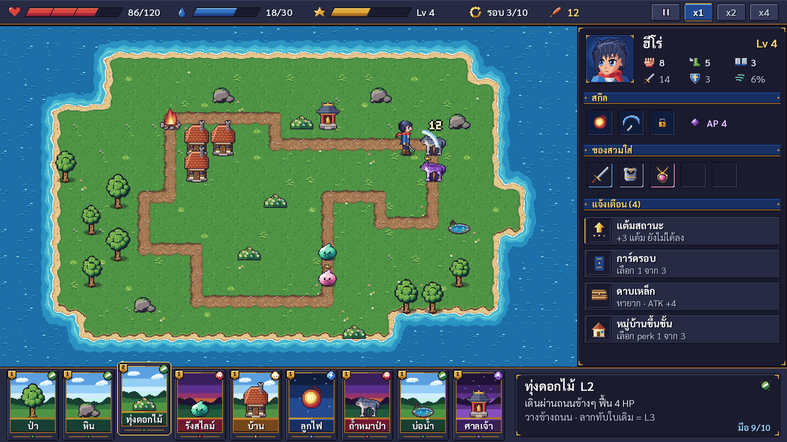

# Art v2 · style test (รอ Phupha ตัดสิน)

ชุดทดลองทิศทางภาพใหม่ หลัง Phupha ดู v1 แล้วบอกว่า (26 ต.ค. 2026) โทนดูเด็กเกินไป อยากได้แนว anime หน่อยๆ ไอคอนต้องเนี้ยบกว่านี้ การ์ดและ HUD ไม่ชอบแบบไม้กับกระดาษ และวัตถุต้องละเอียดและถูกต้องกว่านี้

ยังไม่ใช่ asset ที่เกมใช้ ภาพใน `assets/art/` ยังเป็น v1 จนกว่าจะตกลงทิศทาง แล้วค่อยผลิตทั้งชุดตามนี้



- [เทียบ v1 กับ v2](compare_v1_v2.png)
- [style sheet ทุกชิ้นแบบขยาย](style_sheet_v2.png)

## ต่างจาก v1 ตรงไหน

| เรื่อง | v1 | v2 |
| --- | --- | --- |
| ความละเอียด | 480 x 270 ขยาย x4 | 960 x 540 ขยาย x2 (ได้ 1920 x 1080 เท่าเดิม แต่ละเอียดขึ้น 2 เท่า) |
| ช่องแผนที่ | 16 px | 32 px (แผนที่ยัง 22 x 13 ช่อง = 704 x 416) |
| ตัวละคร | 16 x 16 หัวโต | 32 x 48 สัดส่วนแนว anime ตาโต มีเงาหลายระดับ |
| palette | Endesga 32 (สดแบบของเล่น) | 104 สี เป็น ramp ที่เงาเหลื่อมไปทางน้ำเงิน/ม่วง แสงเหลื่อมไปทางอุ่น |
| UI | ไม้สีเข้ม + กระดาษครีม | แผงกรมท่าเข้ม ขอบทองบาง มุมตัด แถบค่าเอียง |
| การ์ด | 32 x 44 | 64 x 88 มีฉากหลังตามประเภท ป้ายชื่อสีตามประเภท โล่ทองบอกเลเวล |
| ไอคอน | 8 x 8 และ 16 x 16 | 16 x 16 บน HUD, 24 x 24 ในช่องของ สกิล และแจ้งเตือน |
| portrait | 32 x 32 | 56 x 56 ในกรอบ 60 x 60 |

## ขนาดและ layout ที่ระบบต้องเปลี่ยนถ้าใช้ v2

| ของ | v2 |
| --- | --- |
| หน้าจอฐาน | 960 x 540, stretch x2 |
| แถบบน | 960 x 32 ที่ (0, 0) |
| แผนที่ | 704 x 416 ที่ (0, 32), ช่อง 32 px |
| แผงขวา | 256 x 416 ที่ (704, 32) |
| มือการ์ด | 960 x 92 ที่ (0, 448), การ์ดห่างกัน 68 px |
| วัตถุ ฮีโร่ ศัตรู | เฟรม 32 x 48, เส้นเท้าอยู่ y=45, วางให้เส้นเท้าห่างขอบล่างช่อง 3 px (ยื่นขึ้นช่องบน 16 px) |
| การ์ด | 64 x 88, ช่องภาพ (5, 5, 54, 54), ป้ายชื่อ (5, 61, 54, 16) |
| ตัวหนังสือ | Sarabun ประมาณ 11-16 px ที่ความละเอียดฐาน (x2 บนจอ 1080p) |
| เงา | วงรีสี ink0 โปร่ง ~38 % ให้ engine วาดใต้ตัวที่ยืนอยู่ (ไม่อยู่ใน sprite) |

ทุก pixel ใน sprite ต้องเป็นสีใน palette v2 (`tools/art/v2/pal.py`) หรือโปร่งใสสนิท

## สร้างภาพใหม่

```
python3 tools/art/v2/mockup.py --fonts <โฟลเดอร์ Sarabun>   # mockup_v2.png + compare_v1_v2.png
python3 tools/art/v2/sheet.py --fonts <โฟลเดอร์ Sarabun>    # style_sheet_v2.png
```

ค่าเริ่มต้นของ `--fonts` คือ `assets/art/fonts/` ภาพออกที่ `docs/art/v2/`
